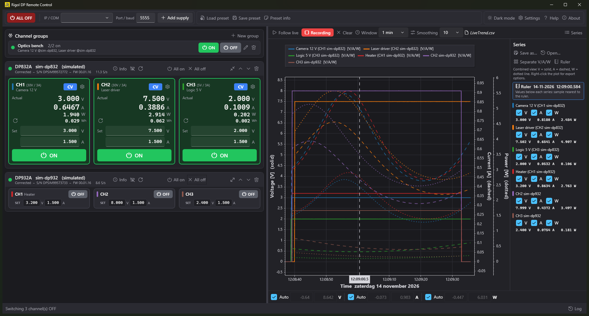
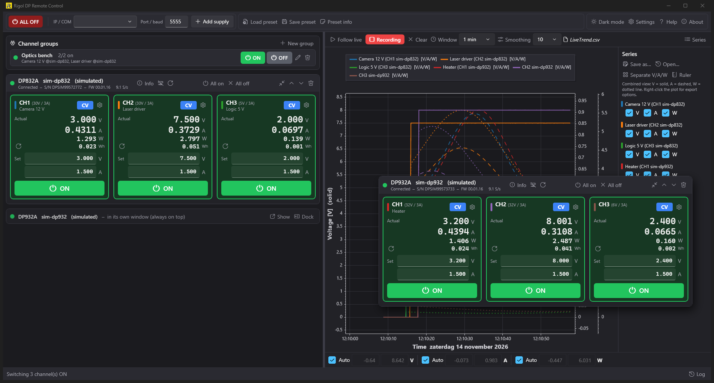
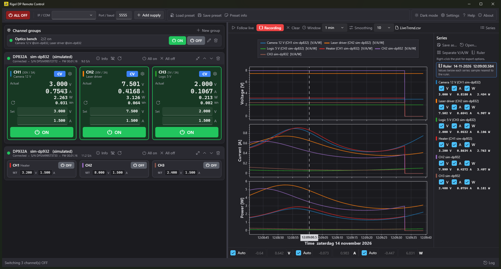
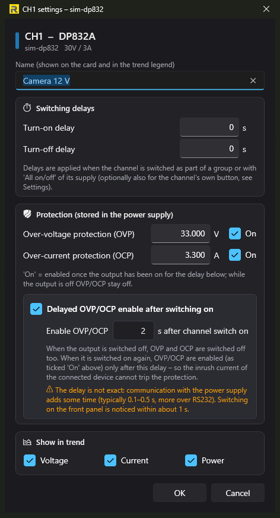
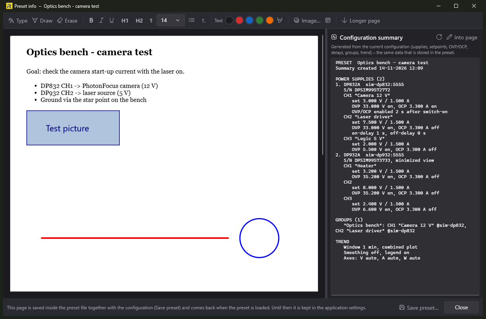
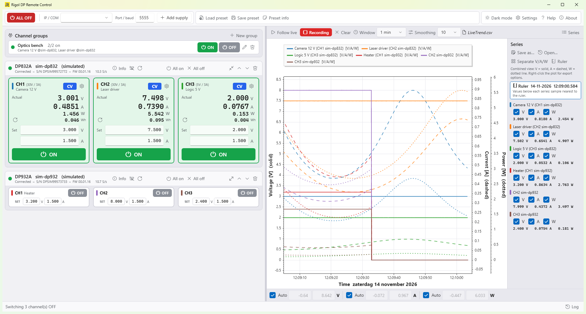
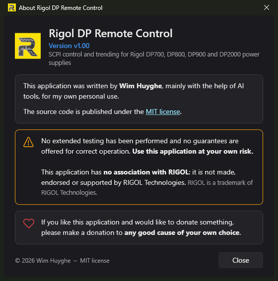

# Rigol DP Remote Control

A lightweight, portable Windows application to control and trend several **Rigol DP700, DP800, DP900 and DP2000** programmable
DC power supplies at the same time – over **LAN** (SCPI on TCP port 5555) or **RS232**. No NI-VISA, no Rigol software and no drivers needed.

> **Disclaimer** – This application was written by Wim Huyghe, mainly with the help of AI tools, for my own personal use.
> No extended testing has been performed and no guarantees are offered for correct operation. **Use it at your own risk.**
> This application has **no association with RIGOL**: it is not made, endorsed or supported by RIGOL Technologies. RIGOL is a trademark of RIGOL Technologies.

## Highlights

1. **Current readout to 0.1 mA** – measured currents are shown with four decimals (1/10 milliampere; the accuracy is that of the supply).
2. **Watt-hour counter** – energy delivered by each channel since it was switched on.
3. **Delayed OCP / OVP** – protection is enabled only after a configurable delay, so the inrush current at power-on does not trip the output.
4. **Power-on / power-off sequences** across several power supplies – channel groups, every channel with its own on- and off-delay.
5. **Extended trending** – voltage, current and power of all channels in one trend: combined or separate plots, ruler, smoothing,
   zoom and scroll while recording, CSV and image export, history viewer for saved trends.
6. **Fully portable** – one executable, no installation and no driver installation.

And further: any number of supplies stacked in one window · set-points, measured values, output state and CV/CC mode per channel ·
channel names · minimized view · supplies and groups can be undocked into small always-on-top windows · presets of the complete
configuration with a notes page (text, pictures, sketches) · dark and light mode · built-in simulator to try it without hardware.

## Download

Get the latest version from the **[Releases page](../../releases/latest)**. Every zip contains `RigolDPRemoteControl.exe`, the help and the license:

| Zip | Windows | Needs on the PC | Size |
|---|---|---|---|
| `RigolDPRemoteControl-v1.00-win-x64.zip` | 64-bit | nothing (self-contained) | ≈ 66 MB |
| `RigolDPRemoteControl-v1.00-win-x64-runtime.zip` | 64-bit | [.NET 10 Desktop Runtime](https://dotnet.microsoft.com/download/dotnet/10.0) x64 | ≈ 22 MB |
| `RigolDPRemoteControl-v1.00-win-x86.zip` | 32- or 64-bit | nothing (self-contained) | ≈ 62 MB |
| `RigolDPRemoteControl-v1.00-win-x86-runtime.zip` | 32- or 64-bit | [.NET 10 Desktop Runtime](https://dotnet.microsoft.com/download/dotnet/10.0) x86 | ≈ 20 MB |

Unzip to a writable folder (not `C:\Program Files`) and start `RigolDPRemoteControl.exe`. Settings, presets and trends are stored next to the exe.
Windows SmartScreen may warn the first time because the exe is not code-signed (“More info” → “Run anyway”).

## Documentation

The complete user guide – including a datasheet summary and a comparison of all supported models – is the same help that the application opens with F1:

- **[Help as web page](https://wimhuyghe.github.io/RigolDPRemoteControl/)** (styled, GitHub Pages)
- **[docs/HELP.md](docs/HELP.md)** (readable directly on GitHub)

## Supported power supplies

| Series | Models | Connection |
|---|---|---|
| DP700 | DP711, DP712 | RS232 |
| DP800 | DP832(A), DP831(A), DP822(A), DP821(A), DP813(A), DP811(A) | LAN, RS232 |
| DP900 | DP932A, DP932U, DP932E | LAN |
| DP2000 | DP2031 | LAN, RS232 |

## Screenshots

| | |
|---|---|
|  **Undocked supply** – an always-on-top window |  **Trend** – separate V / A / W plots with ruler |
|  **Channel settings** – delays and delayed OVP/OCP |  **Preset info** – notes page stored in the preset |
|  **Light mode** |  **About** |

## Build from source

C# / WPF on .NET 10, built with Visual Studio 2026 (or `dotnet build`). See [source/README.md](source/README.md) for the build,
the four publish profiles and the code layout. NuGet dependencies: ScottPlot.WPF and System.IO.Ports.

## License

[MIT](LICENSE) © 2026 Wim Huyghe

If you like this application and would like to donate something, please make a donation to **any good cause of your own choice**.
