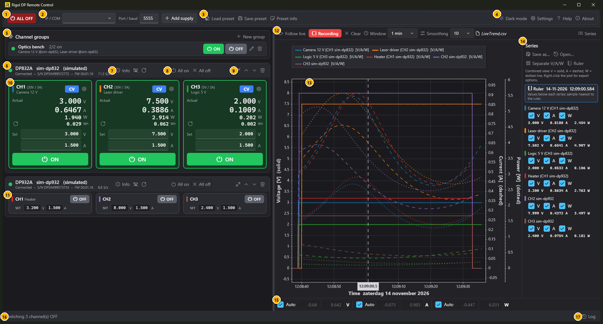
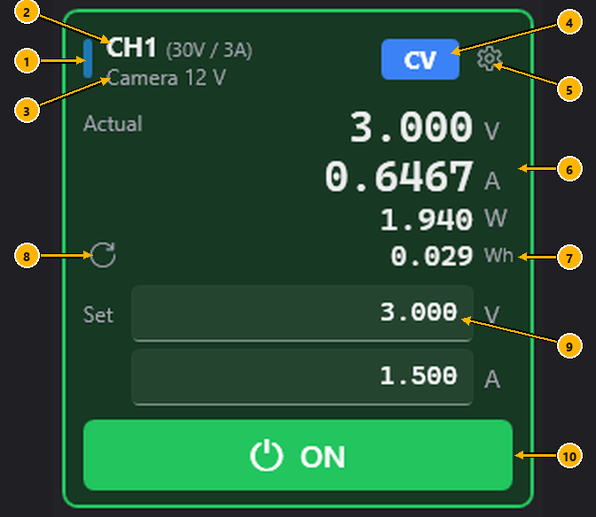
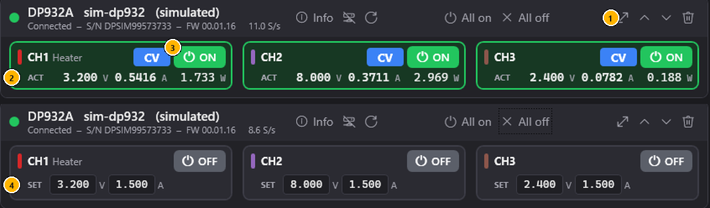
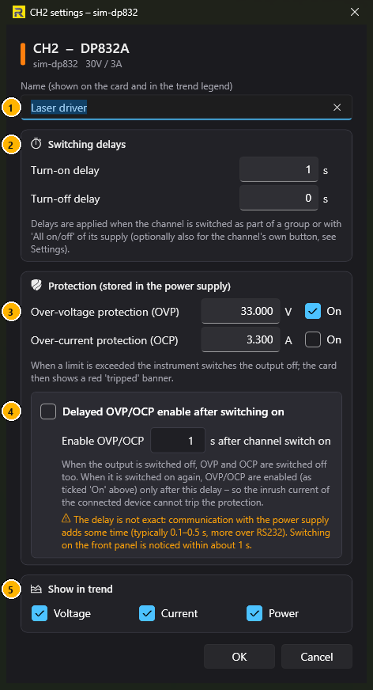
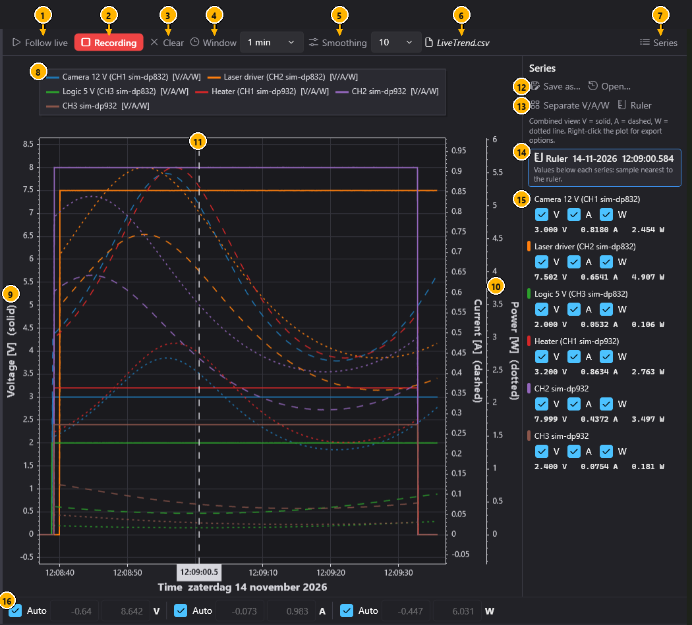

<!-- Generated from source/RigolDPRemoteControl/Help/Help.html by make-docs.ps1 – edit the help there. -->
<!-- The styled version of this help is docs/index.html (GitHub Pages). -->

<h1 id="intro">Rigol DP Remote Control</h1>

A lightweight Windows application to control and trend several Rigol DP700, DP800, DP900 and DP2000 series programmable DC power supplies – over Ethernet (LAN) or RS232.

<b>1. Current readout to 0.1 mA</b>
Measured currents are shown with four decimals – a resolution of 1/10 milliampere.
(The accuracy is that of the power supply, see the <a href="#datasheet">datasheet summary</a>.)

<b>2. Watt-hour counter</b>
The energy delivered by each channel since it was switched on, in Wh – optional, see the <a href="#channel">channel card</a>.

<b>3. Delayed OCP / OVP</b>
Over-current and over-voltage protection are enabled only after a delay, so the inrush current at power-on does not trip the output
(<a href="#chsettings">channel settings</a>).

<b>4. Power-on / power-off sequences</b>
Switch channels of several power supplies together, each after its own on- or off-delay (<a href="#groups">channel groups</a>).

<b>5. Extended trending</b>
Voltage, current and power of all channels in one trend: combined or separate plots, ruler, smoothing, zoom and scroll while recording,
CSV and image export, and a history viewer for saved trends (<a href="#trend">trend</a>).

<b>6. Fully portable, no drivers</b>
One executable that runs without installation: no NI-VISA, Rigol software or other drivers – plain SCPI over LAN or RS232
(<a href="#install">installation</a>).

<h3>Features</h3>
<ul>
<li>Supported models: <b>DP711, DP712</b> (DP700, RS232) · <b>DP832(A), DP831(A), DP822(A), DP821(A), DP813(A), DP811(A)</b> (DP800) · <b>DP932A, DP932U, DP932E</b> (DP900) · <b>DP2031</b> (DP2000).
Other members of these families are accepted too (ratings are read from the instrument).</li>
<li>Any number of supplies at the same time, stacked vertically; one trend on the right is shared by all of them. A <a href="#compact">minimized view</a> per supply fits many supplies on the screen.</li>
<li>Shows set-points <em>and</em> measured values of every channel, the output state and the CV/CC regulation mode.</li>
<li>Channel names, per-channel turn-on/turn-off delays and user-defined channel groups (across supplies).</li>
<li><a href="#presets">Presets</a>: save and load the complete configuration (supplies, set-points, OVP/OCP, names, delays, groups, trend settings).</li>
<li>Fast background sampling with a trend of voltage, current and power (combined or separate plots), smoothing, export to CSV/image and a history viewer for saved trends.</li>
<li>Power supplies and the channel groups can be <a href="#floating">undocked</a> into small windows that stay on top of other programs.</li>
<li>Dark and light mode.</li>
</ul>
<h2 id="install">Installation &amp; requirements</h2>
<ul>
<li><b>No instrument drivers.</b> The application talks SCPI over a plain TCP socket (LAN, port 5555) or a serial port (RS232). No NI-VISA, Rigol Ultra Sigma or any other driver is needed.</li>
<li><b>RS232 (DP700):</b> a built-in COM port needs nothing. A USB-to-RS232 adapter needs the driver of the adapter itself (FTDI, Prolific, CH340 …); Windows normally installs it automatically through Windows Update. The serial port support is part of the application.</li>
<li>Windows 10 or 11. The application is available in four versions – each is one <code>RigolDPRemoteControl.exe</code> plus the <code>Help</code> folder:
<table>
<tr><th>Version (folder)</th><th>Windows</th><th>Needs on the PC</th><th>Size</th></tr>
<tr><td><code>win-x64</code> – self-contained</td><td>64-bit</td><td>nothing</td><td>≈ 66 MB</td></tr>
<tr><td><code>win-x64-runtime</code></td><td>64-bit</td><td>.NET 10 Desktop Runtime (x64)</td><td>≈ 22 MB</td></tr>
<tr><td><code>win-x86</code> – self-contained</td><td>32-bit or 64-bit</td><td>nothing</td><td>≈ 62 MB</td></tr>
<tr><td><code>win-x86-runtime</code></td><td>32-bit or 64-bit</td><td>.NET 10 Desktop Runtime (x86)</td><td>≈ 20 MB</td></tr>
</table>
The self-contained versions need no installation at all. The compact “runtime” versions need the free <b>.NET 10 Desktop Runtime</b> from Microsoft
(Windows asks to download it when it is missing). There is no Linux version: the user interface uses WPF, which only exists on Windows.</li>
<li>The application is portable: copy the folder anywhere. Settings, presets and trends are stored next to the executable, in the folders <code>settings</code> and <code>trend</code>
(so the folder must be writable – do not place it in <code>C:\Program Files</code>).</li>
</ul>
<h2 id="instrument">Preparing the power supply</h2>
<h3>LAN – DP800, DP900, DP2000</h3>
<ol>
<li>Connect the LAN port on the rear panel to your network (or directly to the PC).
 <small>DP800 without “A” (DP832, DP831 …): LAN is the INTERFACE-DP800 option; on the “A” models it is standard. DP900 and DP2000: always present.</small></li>
<li>Set up the LAN on the instrument (DP800: <kbd>Utility</kbd> → <b>I/O Config</b> → <b>LAN</b>; DP900/DP2000: <b>Utility</b> → <b>I/O</b> → <b>LAN</b> on the touch screen). Select DHCP or a static IP address, apply, and note the IP address.</li>
<li>The SCPI socket port is <b>5555</b> (the default in this application). If your instrument shows another socket port, enter it in the <b>Port / baud</b> field.</li>
<li>Make sure the PC can reach the instrument (e.g. <code>ping 192.168.1.10</code>). Firewalls must allow outgoing TCP to port 5555.</li>
</ol>
<h3>RS232 – DP700 (and optionally DP800 / DP2000)</h3>
<ol>
<li>Connect the RS232 port (9-pin) to the PC with a <b>straight</b> (not null-modem) cable, or with a USB-to-RS232 adapter. Note the COM port number (Windows Device Manager → Ports).</li>
<li>On the instrument check the RS232 settings: baud rate (default <b>9600</b>), 8 data bits, no parity, 1 stop bit. The application always uses 8N1 without flow control.</li>
<li>In the toolbar enter the COM port (e.g. <code>COM3</code>) in the <b>IP / COM</b> box and the baud rate in <b>Port / baud</b> (or type <code>COM3:19200</code>).
When the port field still holds the LAN default 5555, 9600 baud is used.</li>
</ol>

While the application is connected, the instrument is in remote mode (front panel keys locked, “RMT” shown). On disconnect and on exit the application returns the instrument to local control (can be disabled in Settings).

RS232 is much slower than LAN: the DP700 needs up to 100 ms per command, so expect roughly 2–4 samples per second for a DP700.

<h2 id="quick">Quick start</h2>
<ol>
<li>Type the IP address (or COM port) of the supply in the <b>IP / COM</b> box of the toolbar and press <b>Add supply</b> (or <kbd>Enter</kbd>). Use <code>192.168.1.10:5556</code> for a different port.</li>
<li>The application connects, identifies the model, creates a card for every channel and <b>reads the settings stored in the instrument</b> (set-points, output state, protection). Nothing is changed on the instrument by connecting.</li>
<li>Change a set-point: click in the voltage or current box, type the value and press <kbd>Enter</kbd>.</li>
<li>Switch a channel with its big <b>ON/OFF</b> button.</li>
<li>The trend on the right starts automatically. Use <b>Save as…</b> (in the Series panel) to keep a trend.</li>
<li>When everything is set up, use <b>Save preset</b> to store the complete configuration.</li>
</ol>

The addresses are remembered: next time the application starts, it reconnects to all supplies that were connected when it was closed, and the drop-down lists previously used addresses.

<h2 id="main">Main window</h2>

The toolbar at the top has three boxes: on the left <b>ALL OFF</b> and adding supplies, in the middle the <b>presets</b>, on the right <b>view, settings and help</b>.
The power supplies are stacked on the left, the trend of all supplies is on the right.

<figure>

<figcaption>Main window (maximized on a 1920 × 1080 screen) with two simulated supplies: a DP832A in the full view and a DP932A in the minimized view.</figcaption>
</figure>
<ol class="callouts two">
<li><b>ALL OFF</b> – switch off every output immediately.</li>
<li><b>Add a supply</b>: IP address or COM port, port / baud rate, Add supply.</li>
<li><b>Presets</b>: load / save the complete configuration, preset info page (<a href="#presets">Presets</a>).</li>
<li><b>Dark mode</b>, application <b>Settings</b>, this <b>Help</b> and <b>About</b>.</li>
<li><b>Channel groups</b> – switch several channels together, with their delays (<a href="#groups">Groups</a>).</li>
<li><b>Supply header</b>: status dot, model, address, serial number, firmware and sample rate.</li>
<li><b>Info</b>, <b>Disconnect</b> and <b>Re-read</b> (<a href="#device">Power supply panel</a>).</li>
<li><b>All on / All off</b> for the channels of this supply.</li>
<li><b>Minimize</b>, move up / down and remove the supply.</li>
<li><b>Channel card</b> – values, set-points and ON/OFF of one channel (<a href="#channel">Channel card</a>).</li>
<li>A supply in the <b>minimized view</b> (<a href="#compact">Minimized view</a>).</li>
<li><b>Trend toolbar</b>: follow live, recording, clear, file name, time window, smoothing (<a href="#trendbar">Trend</a>).</li>
<li><b>Trend</b> of voltage, current and power, here with the ruler switched on.</li>
<li><b>Series panel</b>: trend file, layout, ruler and the series to plot.</li>
<li><b>Scaling bar</b>: automatic or manual range of the V, A and W axes.</li>
<li><b>Status bar</b> with the last message.</li>
<li><b>Log</b> – all messages and errors of this session.</li>
</ol>
<table>
<tr><th>Element</th><th>Function</th></tr>
<tr><td>ALL OFF</td><td>Immediately switches off every output of every connected supply – no delays, also cancels pending delayed switching.</td></tr>
<tr><td>IP / COM, Port / baud, <b>Add supply</b></td><td>Add a power supply: IP address or host name (LAN) or COM port (RS232). The drop-down shows addresses used before.</td></tr>
<tr><td>Load preset / Save preset / Preset info</td><td>Load or save the complete configuration; <b>Preset info</b> opens the notes page of the setup, see <a href="#presets">Presets</a> and <a href="#presetinfo">Preset info</a>.</td></tr>
<tr><td>Dark mode</td><td>Toggle between dark and light mode (remembered).</td></tr>
<tr><td>Settings</td><td>Application settings (sampling, time-outs, behaviour), see <a href="#settings">Settings</a>.</td></tr>
<tr><td>Help (<kbd>F1</kbd>)</td><td>Opens this page.</td></tr>
<tr><td>About</td><td>Version, author, license (MIT), link to the source code and downloads, and the disclaimer – see <a href="#about">About</a>.</td></tr>
<tr><td>Status bar / <b>Log</b></td><td>Last message; the Log button shows the history of messages and errors.</td></tr>
<tr><td>Splitter</td><td>Drag the vertical bar between the supplies and the trend to resize (remembered).</td></tr>
</table>
<h3 id="channel">Channel card</h3>
<figure class="narrow">

</figure>
<ol class="callouts">
<li><b>Colour bar</b> – the colour of this channel in the trend.</li>
<li><b>Channel and rating</b> – e.g. <b>CH1</b> <small>(30V / 3A)</small>: the rating of the output in brackets next to the channel number.</li>
<li><b>Name</b> – only the logical name is shown, so it is not shortened. Double-click the channel to rename.
Delays and OVP/OCP settings are not shown on the card; open the channel settings (5) to see or change them. The line is always reserved, so cards with and without a name look the same.</li>
<li><b>Mode badge</b>: CV constant voltage, CC constant current (the current limit is active),
UR unregulated, OFF output off.</li>
<li><b>Channel settings</b> – name, delays, OVP/OCP, delayed protection and trend (<a href="#chsettings">Channel settings</a>).</li>
<li><b>Actual</b> – measured voltage, current and power (large digits). The digits are dimmed while the output is off.</li>
<li><b>Watt-hour counter</b> (optional, switch it on in <a href="#settings">Settings</a>) – the energy the channel delivered since its output was switched on, in Wh (kWh above 1000 Wh).
It restarts at zero every time the output is switched on (also from the front panel or by a group) and keeps its value after switching off, until the next switch-on.
The counter integrates the measured power of every sample; a pause of more than 30 s without measurements (connection lost) is not counted. It is not stored when the application is closed.</li>
<li><b>Reset</b> – sets the watt-hour counter back to zero at any moment.</li>
<li><b>Set</b> – voltage set-point and current limit. Click the box, type a value and press <kbd>Enter</kbd> to send it.
<kbd>Esc</kbd> or leaving the box without <kbd>Enter</kbd> restores the value of the instrument. Units (V, mV, A, mA) and both “.” and “,” are accepted.
For DP831 CH3 (negative output) you may type the value with or without minus sign.</li>
<li><b>ON / OFF button</b> – green with a green card border and background when the output is ON, grey when off.</li>
</ol>
<ul>
<li>When delayed switching is pending a yellow countdown (“ON in 1.5 s”) is shown under the button; click it to cancel.</li>
<li>A red OVP / OCP tripped banner appears when the instrument switched the output off because of a protection. Remove the cause and press <b>Clear</b>.</li>
</ul>

Changes made on the front panel of the instrument are picked up automatically (set-points and output state are re-read every second by default).

<h3 id="compact">Minimized view</h3>

The <b>minimize</b> button (first button in the header of a supply) switches that supply to a compact view with one small card per channel, so more supplies fit on the screen without scroll bars. Press it again for the full view. The choice is remembered per supply (and stored in presets).

<figure>

<figcaption>The same supply in the minimized view: outputs on (top) and off (bottom).</figcaption>
</figure>
<ol class="callouts two">
<li><b>Full view</b> – back to the full channel cards.</li>
<li><b>ACT</b> – measured voltage, current and power while the output is on.</li>
<li><b>Mode badge and ON/OFF button</b> of the channel.</li>
<li><b>SET</b> – set-points while the output is off; they can be edited here directly.</li>
</ol>
<ul>
<li>Output <b>off</b>: the card shows <b>SET</b> with the voltage set-point and current limit. These can be <b>edited directly</b>: type a value and press <kbd>Enter</kbd> (<kbd>Esc</kbd> cancels).</li>
<li>Output <b>on</b>: the card turns green and shows <b>ACT</b> with the measured voltage, current and power, plus the CV/CC badge.</li>
<li>The ON/OFF button, protection-trip banner and delayed-switch countdown remain available. Double-click the channel name for its settings.</li>
</ul>
<h3 id="chsettings">Channel settings (gear button)</h3>

The gear button on a channel card opens the settings of that channel. Delays and protection settings are only shown here (not on the card, to keep the channel name readable).

<figure class="narrow">

</figure>
<ol class="callouts">
<li><b>Name</b> of the channel.</li>
<li><b>Switching delays</b> – turn-on and turn-off delay.</li>
<li><b>Protection</b> – OVP / OCP level and enable, stored in the power supply.</li>
<li><b>Delayed OVP/OCP enable</b> after switching on (inrush current).</li>
<li><b>Show in trend</b> – which quantities of this channel are plotted.</li>
</ol>
<ul>
<li><b>Name</b> – logical name (e.g. “Logic 5V”). Shown on the card, in groups and in the trend legend.</li>
<li><b>Turn-on / turn-off delay</b> (seconds) – used when the channel is switched with a group or with <i>All on / All off</i> of its supply
(optionally also by its own button – see Settings).</li>
<li><b>OVP / OCP</b> – over-voltage and over-current protection level and enable. These are stored <i>in the power supply</i>.</li>
<li><b>Delayed OVP/OCP enable after switching on</b> – prevents protection trips caused by the <b>inrush current</b> of the connected device:
<ul>
<li>when the output is switched <b>off</b>, OVP and OCP are switched off too;</li>
<li>when the output is switched <b>on</b>, OVP/OCP stay off and are enabled (as ticked “On”) only after the configured delay (seconds);</li>
<li>while the delay runs, the card shows OVP/OCP enabled in x s as a countdown;</li>
<li>this also works when the output is switched on the front panel (noticed within about 1 s) and for group / delayed switching.</li>
</ul>
<b>The delay is not exact:</b> communication with the power supply adds some time (typically 0.1–0.5 s, more over RS232). Choose the delay with some margin.</li>
<li><b>Show in trend</b> – which quantities (V, A, W) of this channel are drawn in the trend.</li>
</ul>
<h3 id="device">Power supply panel &amp; info</h3>

The header of each supply shows a status dot (green connected, yellow connecting, red error – the application keeps retrying every 3 s), the model and address, the serial number, firmware and the actual sample rate (S/s = complete measurement cycles per second).
Its buttons are arranged in three groups:

<table>
<tr><th>Group</th><th>Button</th><th>Function</th></tr>
<tr><td rowspan="3">Left – information &amp; connection</td><td>Info</td><td>Model and series, manufacturer, description, serial number, MAC address (LAN models), firmware, SCPI version, address, interfaces, output ratings and the raw <code>*IDN?</code> answer. <b>Copy</b> puts it on the clipboard.</td></tr>
<tr><td>Connect / Disconnect</td><td>A disconnected supply stays in the list but is not reconnected automatically at the next start.</td></tr>
<tr><td>Re-read (↻)</td><td>Re-read set-points and output states immediately.</td></tr>
<tr><td>Middle – outputs</td><td>All on / All off</td><td>Switch all channels of this supply (with their delays).</td></tr>
<tr><td rowspan="3">Right – view</td><td>Minimize / full view</td><td>Switch between the full channel cards and the <a href="#compact">minimized view</a>.</td></tr>
<tr><td>▲ ▼</td><td>Change the order of the supplies.</td></tr>
<tr><td>Delete</td><td>Remove the supply from the application (outputs are not changed). Its channels disappear from the groups and its curves and series check boxes from the live trend.</td></tr>
</table>
<h3 id="groups">Channel groups &amp; delays</h3>

A group is a user-defined set of channels – they may belong to different power supplies. Create one with <b>+ New group</b> in the header of the <i>Channel groups</i> panel, give it a name and tick the channels.
The group editor lists every channel with its <b>name</b>, <b>on delay</b> and <b>off delay</b>, so you can name the channels and set up the switching sequence in one place (the values are stored per channel, so they are the same as in the channel settings).
The group row shows how many of its channels are on (dot: green = all on, yellow = some on, grey = all off) and has <b>ON</b> and <b>OFF</b> buttons.

When a group is switched ON, each channel is switched on after <i>its own</i> turn-on delay, counted from the moment the button is pressed. Switching OFF uses the turn-off delays.
Example for a power sequencing: core supply on-delay 0 s, I/O supply 0.5 s, motor supply 2 s; off-delays in reverse order.
A new command for a channel cancels a pending delayed command for that channel.

<h3 id="floating">Undocking: a supply or the groups in their own window</h3>

A power supply – or the <i>Channel groups</i> panel – can be taken out of the main window and shown in its own small window that stays
<b>always on top</b> of other programs, for example next to the software of the device under test. The main window can even be minimized meanwhile.
The floating window has no frame, title bar or buttons: only the panel itself is shown, and it is moved by dragging its header.

<ul>
<li><b>Undock</b>: press the mouse on the <b>header</b> of the supply (on the model / address text, not on a button) or on the title
<i>Channel groups</i>, and drag it <b>out of the supply list</b> (for example over the trend or outside the application).
As soon as the mouse leaves the supply list, the panel becomes a separate window that follows the mouse; release it where you want it.</li>
<li><b>Dock</b>: drag the floating panel by its header back <b>onto the supply list</b> of the main window.
The list then shows Release to dock here; release the mouse to put the panel back.
A floating window can therefore be placed anywhere except over the supply list.</li>
<li>While a panel is floating, the supply list shows a slim placeholder with <b>Show</b> (bring the window to the front) and <b>Dock</b> (put it back).
Closing the floating panel with <kbd>Alt</kbd>+<kbd>F4</kbd> also docks it.</li>
<li>The floating window works exactly like the panel in the main window: switching, set-points, minimized view, settings, info, … Sampling and trending continue normally.</li>
<li>Which panels are floating and where they are is remembered: they open again at the next start. For supplies this is also stored in presets.</li>
</ul>
<h2 id="presets">Presets (save / load configuration)</h2>

A preset stores the <b>complete configuration</b> in one file (<code>*.dppreset</code>, in <code>settings\presets</code> by default):

<table>
<tr><th>Part</th><th>Contents</th></tr>
<tr><td>Power supplies</td><td>Address (IP/port or COM/baud), model, order, minimized view; per channel: name, on/off delay, trend colour and trend selection (V/A/W).</td></tr>
<tr><td>Settings in the instruments</td><td>Per channel: voltage set-point, current limit, OVP level + enable, OCP level + enable.</td></tr>
<tr><td>Groups</td><td>All channel groups and their members.</td></tr>
<tr><td>Plotting</td><td>Time window, smoothing, legend, combined/separate V/A/W plots, auto/manual scaling and min/max of each axis.</td></tr>
<tr><td>Preset info</td><td>The notes page of the setup (text, pictures, drawing) – see <a href="#presetinfo">Preset info</a>. Everything is in the <b>one</b> preset file.</td></tr>
</table>
<ul>
<li><b>Save preset</b> reads the current set-points and OVP/OCP of every connected supply. Supplies that are not connected are stored without instrument settings (you are warned).</li>
<li><b>Load preset</b> replaces the supplies, groups and trend settings by those of the preset, reconnects and writes the stored set-points and OVP/OCP to each supply as soon as it is connected
(only when the connected model matches the model in the preset).</li>
<li>The output states are <b>not</b> part of a preset: after loading, <b>all outputs are off</b>. Use a group or <i>All on</i> to switch on.</li>
</ul>

<b>Safety:</b> when one or more channels are on (or have a delayed switch pending) while a preset is loaded, the application first shows a warning that
<b>all channels of all power supplies will be switched off</b> (immediately, without delays). Only after you confirm are the outputs switched off and checked; if switching off fails, the preset is not loaded.

The live trend keeps the history of supplies that are also in the preset; curves of supplies that are not in the preset are removed.

<h3 id="presetinfo">Preset info (notes page of the setup)</h3>

<b>Preset info</b> (middle of the top toolbar) opens a notes page – like a page in a notebook app, but without any Office software – for everything you want to remember about the setup:
which device is connected to which channel, how the wiring must be done, what the goal of the test is, photos of the bench, …

<ul>
<li><b>Type</b> mode: text with <b>bold</b>, <i>italic</i>, underline, headings (H1, H2), font size, colours, highlighting, bullet and numbered lists, the date/time.
Paste a picture or screenshot with <kbd>Ctrl</kbd>+<kbd>V</kbd>, or insert one with <b>Image…</b>.</li>
<li><b>Draw</b> mode: draw with the mouse or a pen on the page (pen colours, thin / thick, yellow marker) – e.g. a wiring sketch. <b>Erase</b> removes strokes. <b>Longer page</b> adds room at the bottom.</li>
<li><b>Configuration summary</b> (right): a readable summary of the configured settings – supplies, set-points, OVP/OCP, delays, groups and trend settings – created from the current configuration (↻ refreshes it).
<b>Into page</b> copies the summary into the page as a snapshot you can annotate.</li>
<li>The page is stored <b>inside the preset file</b> together with the configuration when you save the preset (also with <b>Save preset…</b> in this window) and is restored when the preset is loaded.
Until then it is kept in the application settings, so nothing is lost when the application is closed.</li>
</ul>
<h2 id="trend">Trend</h2>

The trend shows the measured voltage, current and power of the channels. Each channel has its own colour, the same as the colour bar on its card. Two layouts are available with the <b>Separate V/A/W</b> button at the top of the Series panel (also in the right-click menu; the choice is remembered):

<ul>
<li><b>Combined</b> (button off): one plot with three y-axes – voltage (solid lines, left axis), current (dashed, first right axis) and power (dotted, second right axis).</li>
<li><b>Separate</b> (button on): three stacked plots – voltage, current and power – with solid lines and one common time axis.
Scrolling or zooming the time in one plot moves all three; the value axis of each plot zooms on its own. Images and exports contain all three plots.</li>
</ul>

The <b>legend</b> is shown <b>above</b> the trend. It uses the logical name followed by channel and address in brackets – e.g. <code>Logic 5V (CH1 192.168.1.10)</code> – or <code>CH1 192.168.1.10</code> when no name is set, followed by the plotted quantities (<code>[V/A/W]</code>).

Sampling runs on a separate background task per power supply, as fast as the instruments answer (typically 5–15 complete cycles per second per LAN supply, depending on model and number of channels; fewer over RS232). The display is refreshed independently, so the user interface stays responsive.

<h3 id="trendbar">Trend toolbar, panels and scaling bar</h3>
<figure>

<figcaption>Live trend in the combined layout with the ruler switched on.</figcaption>
</figure>
<ol class="callouts two">
<li><b>Follow live</b> – keep the newest samples in view.</li>
<li><b>Start / Recording</b> – start or stop recording the trend.</li>
<li><b>Clear</b> the trend.</li>
<li><b>Window</b> – visible time span.</li>
<li><b>Smoothing</b> on/off and number of samples.</li>
<li>Name of the <b>trend file</b> that is being recorded – shortened with “…” when there is not enough room; point at it to see the full name.</li>
<li><b>Series</b> – show / hide the Series panel.</li>
<li><b>Legend</b> – name, channel and address of every series.</li>
<li><b>Voltage axis</b> (solid lines).</li>
<li><b>Current axis</b> (dashed) and <b>power axis</b> (dotted).</li>
<li><b>Ruler</b> – drag it or click in the plot; its time is shown at the bottom.</li>
<li><b>Save as…</b> and <b>Open…</b> a trend file.</li>
<li><b>Separate V/A/W</b> layout and <b>Ruler</b> on/off.</li>
<li>Exact <b>time of the ruler</b>.</li>
<li>Per series the <b>V / A / W</b> check boxes and the values at the ruler.</li>
<li><b>Scaling bar</b> – Auto or manual min / max per axis.</li>
</ol>
<table>
<tr><th>Place</th><th>Contents</th></tr>
<tr><td>Toolbar</td><td><b>Follow live</b> · <b>Start / Recording</b> · <b>Clear</b> · <b>Window</b> (visible time span) · <b>Smoothing</b> (+ number of samples) · name of the trend file that is being recorded, in italics (history window: the opened file; shortened with “…” when there is not enough room, full name in the tooltip) · on the far right <b>Series</b> (show / hide the Series panel). <b>Fit all</b> and <b>Reset zoom</b> are in the right-click menu (and middle-click / double-click).</td></tr>
<tr><td>Series panel (right)</td><td><b>Save as…</b> and <b>Open…</b> (open a saved trend in a history window), <b>Separate V/A/W</b> and <b>Ruler</b> buttons, the ruler time and per channel the V / A / W check boxes and the values at the ruler</td></tr>
<tr><td>Scaling bar (bottom)</td><td>Auto / manual scaling with min and max for the V, A and W axes</td></tr>
</table>
<h3 id="trendrec">Recording &amp; files</h3>
<ul>
<li>Recording starts automatically when the application starts (can be disabled in Settings) and writes to <code>trend\LiveTrend.csv</code>.</li>
<li><b>Start</b> (re)starts the trend: the plot is cleared and <code>LiveTrend.csv</code> is <b>overwritten</b>. This prevents an accumulation of useless trend files.</li>
<li><b>Recording</b> (red) – click to stop. The data stays visible.</li>
<li><b>Save as…</b> copies the trend recorded so far to a file name of your choice (in the <code>trend</code> folder by default) and continues recording into that file. A saved trend is never overwritten automatically.</li>
<li><b>Clear</b> clears the trend (and restarts the default trend file).</li>
<li>The CSV file contains one row per channel sample: <code>Timestamp, Label, SeriesKey, Voltage [V], Current [A], Power [W], Mode</code>, with comment lines starting with <code>#</code>. It can be opened in Excel or the history viewer.</li>
</ul>
<h3 id="mouse">Mouse and keyboard controls</h3>

A <b>region</b> is the rectangle you select with the mouse. This table can also be opened next to the trend with right-click → <b>Trend navigation (mouse / keys)…</b>

<table>
<tr><th>Mouse / keys</th><th>Action</th></tr>
<tr><td>Left-click-drag</td><td>Pan (scroll time and values)</td></tr>
<tr><td>Right-click-drag</td><td>Zoom (drag right/up = zoom in, left/down = zoom out)</td></tr>
<tr><td>Middle-click-drag</td><td>Zoom to the selected region</td></tr>
<tr><td><kbd>ALT</kbd> + left-click-drag</td><td>Zoom to the selected region</td></tr>
<tr><td>Scroll wheel</td><td>Zoom at the mouse cursor</td></tr>
<tr><td>Right-click</td><td>Show the menu (export, layout, ruler, legend, …)</td></tr>
<tr><td>Middle-click</td><td>Auto-axis: show the complete trend with autoscaled axes (same as <b>Fit all</b>)</td></tr>
<tr><td>Double-click</td><td>Back to the live view with autoscaling (history window: the complete trend) – same as <b>Reset zoom</b></td></tr>
<tr><td><kbd>CTRL</kbd> + left-click-drag</td><td>Pan horizontally (time only)</td></tr>
<tr><td><kbd>SHIFT</kbd> + left-click-drag</td><td>Pan vertically (values only)</td></tr>
<tr><td><kbd>CTRL</kbd> + right-click-drag</td><td>Zoom horizontally (time only)</td></tr>
<tr><td><kbd>SHIFT</kbd> + right-click-drag</td><td>Zoom vertically (values only)</td></tr>
<tr><td><kbd>CTRL</kbd> + <kbd>SHIFT</kbd> + right-click-drag</td><td>Zoom evenly (time and values by the same factor, around the mouse position)</td></tr>
<tr><td>Left-click (ruler on)</td><td>Move the ruler to the clicked time; drag the ruler line to move it</td></tr>
</table>

In the separate V/A/W layout the time axis is shared: panning or zooming the time in one plot moves all three; the value axis zooms only in the plot under the mouse.

<h3 id="trendnav">Scrolling, zooming, scaling</h3>
<ul>
<li>Zooming with the mouse always works in <b>both directions</b> (time and value), also when Auto scaling is ticked: the first mouse zoom or scroll pauses autoscaling (and, in the live trend, following) so your zoom is kept. A note in the plot shows that the view is zoomed.</li>
<li><b>Reset zoom</b> (right-click menu, or <b>double-click</b> in the plot) undoes the zoom: the live trend returns to the live view, a history trend shows the complete trend, and autoscaling is applied again to every axis with Auto ticked (manual axes return to their min/max).</li>
<li><b>Follow live</b> keeps the newest samples in view. While zoomed/scrolled, <b>sampling and recording continue in the background</b>. Pressing <b>Follow live</b> again returns to the live view <i>with autoscaling</i> (same as Reset zoom).</li>
<li><b>Window</b> selects the visible time span (10 s … 12 h, or All).</li>
<li><b>Fit all</b> (right-click menu or <b>middle-click</b>) shows the complete trend with autoscaled axes.</li>
<li>The scaling bar at the bottom of the trend has one group per axis, identified by its unit: <b>V</b> (voltage), <b>A</b> (current) and <b>W</b> (power).
With <b>Auto</b> ticked the axis fits the visible data; the min/max fields are then greyed out and <b>follow the actual autoscaled range</b>.
Untick Auto to scale manually: the axis keeps exactly the scale that was shown, and you can type a new minimum (left field) and maximum (right field) and press <kbd>Enter</kbd> – hover over a field to see which it is
(values in the unit of the group, e.g. <code>0.5</code> or <code>500m</code> for 500 mA). Ticking Auto again immediately re-applies autoscaling to that axis.</li>
<li><b>Series</b> (far right of the trend toolbar) shows the panel where you can choose per channel which quantities (V, A, W) are plotted. When a supply is removed, its entries disappear from this panel.</li>
</ul>
<h3 id="ruler">Ruler (read values at a moment in time)</h3>
<ul>
<li><b>Ruler</b> at the top of the Series panel (or right-click → Show ruler / Hide ruler) shows a dashed vertical line through the plot(s), with its time at the bottom.</li>
<li>The <b>values of all plotted series at the ruler</b> are shown in the Series panel, below each series (only the selected quantities V / A / W).
The panel header shows the exact date and time of the ruler. The Series panel opens automatically when the ruler is switched on.</li>
<li>Move the ruler by <b>dragging</b> it (the mouse pointer changes to ↔ near the line), or <b>click</b> anywhere in the plot to put it there.</li>
<li>The value is the sample nearest to the ruler; with smoothing on it is the smoothed value, as plotted. Outside the recorded time of a series “no data at the ruler” is shown.</li>
<li>The ruler stays at its moment in time: in the live trend it moves to the left as new data arrives. Switch it off and on again to bring it back to the middle of the view.</li>
</ul>
<h3 id="smooth">Smoothing</h3>

<b>Smoothing</b> applies a centred moving average (3 … 500 samples, selectable) to the displayed curves. When smoothing is active a clearly visible orange banner
SMOOTHING ON … is shown directly above the plot (so it never hides trend data) and “(smoothed N)” is appended to every legend entry, also in saved images.
Smoothing only affects the display; recorded and exported data is always raw.

<h3 id="export">Export (right mouse button)</h3>

Right-click (without dragging) in the plot:

<ul>
<li><b>Save image…</b> – PNG, JPG, SVG (combined layout) or BMP at the current size.</li>
<li><b>Copy image to clipboard</b>.</li>
<li><b>Export CSV – all data…</b> / <b>Export CSV – visible time range…</b></li>
<li><b>Reset zoom</b>, <b>Fit all</b>, <b>Autoscale all axes</b>, <b>Separate V / A / W plots</b> or <b>Combined plot</b>, <b>Show ruler</b> or <b>Hide ruler</b>, <b>Show / hide legend</b>, <b>Clear trend</b>.</li>
</ul>
<h3 id="history">Trend history viewer</h3>

<b>Open…</b> (top of the Series panel) opens a saved trend (CSV) in a separate history window. It has the same functionality as the live trend (zoom, scroll, axis scaling, smoothing, series selection, export) and can be used while live trending continues in the main window. Several history windows can be open at once.
A trend file can also be opened by passing it on the command line: <code>RigolDPRemoteControl.exe mytrend.csv</code> (e.g. drag the file onto the exe).

<h2 id="settings">Settings &amp; files</h2>
<table>
<tr><th>Setting</th><th>Meaning</th></tr>
<tr><td>Extra pause between samples</td><td>0 = sample as fast as possible (default). Increase to reduce network load.</td></tr>
<tr><td>Re-read set-points / output state every</td><td>Interval for reading values that rarely change (front-panel changes, protection trips). Default 1000 ms.</td></tr>
<tr><td>Command timeout</td><td>Maximum time to wait for an answer (default 5000 ms; the former default of 2000 ms is raised automatically, because DP800 supplies sometimes pause about 2 s). After a timeout the LAN connection is re-established immediately; only when that fails too is an error shown and retried every 3 s. Polling cycles that take longer than 1.5 s are noted in the log.</td></tr>
<tr><td>Default SCPI port</td><td>5555 (LAN socket port of the DP800/DP900/DP2000).</td></tr>
<tr><td>Start trend recording on start</td><td>Start recording to LiveTrend.csv when the application starts.</td></tr>
<tr><td>Apply delays to a channel's own button</td><td>Normally a channel's ON/OFF button switches immediately; tick to use its delays here too.</td></tr>
<tr><td>Return to local on exit</td><td>Unlock the front panel when disconnecting / exiting.</td></tr>
<tr><td>Show a watt-hour counter</td><td>Shows the energy line (Wh) with its reset button on every channel card (off by default, it takes some space).</td></tr>
</table>
<table>
<tr><th>File / folder (next to the exe)</th><th>Contents</th></tr>
<tr><td><code>settings\settings.json</code></td><td>All settings: supplies (address, port/baud), channel names, delays, colours, minimized view, groups, trend and window settings, theme.</td></tr>
<tr><td><code>settings\presets\*.dppreset</code></td><td>Saved presets: configuration and preset info page in one JSON file (text with pictures and the drawing are embedded).</td></tr>
<tr><td><code>settings\error.log</code></td><td>Unexpected errors (only created when something goes wrong).</td></tr>
<tr><td><code>trend\LiveTrend.csv</code></td><td>Default trend file – overwritten when trending (or the application) is restarted.</td></tr>
<tr><td><code>trend\*.csv</code></td><td>Trends you saved with <b>Save as…</b> and exports.</td></tr>
<tr><td><code>Help\Help.html</code></td><td>This help file.</td></tr>
</table>

<b>Messages and confirmations</b> (for example “Clear the trend?”) follow the dark or light mode of the application and can be copied with <kbd>Ctrl</kbd>+<kbd>C</kbd>.
<b>Open / save</b> uses the standard Windows file dialogs, with all their functions (search, preview, quick access, …); they follow the Windows dark/light setting.

<h2 id="sim">Simulated power supplies</h2>

To explore the application without hardware, add a supply with the address <code>sim</code> (simulates a DP832A). Other models:
<code>sim-dp831</code>, <code>sim-dp822</code>, <code>sim-dp821</code>, <code>sim-dp813</code>, <code>sim-dp811</code>, <code>sim-dp711</code>, <code>sim-dp712</code>, <code>sim-dp932</code>, <code>sim-dp932u</code>, <code>sim-dp932e</code>, <code>sim-dp2031</code>;
add a suffix to create several of the same kind (<code>sim-dp832-2</code>). Each simulated channel drives a slowly varying resistive load, so CV/CC changes and protections can be tried out.

<h2 id="trouble">Troubleshooting</h2>
<table>
<tr><th>Problem</th><th>Solution</th></tr>
<tr><td>“Cannot connect … actively refused” / time-out (LAN)</td><td>Check the IP address on the instrument, cable, subnet, and that LAN is installed (option on DP800 non-“A” models). Check that port 5555 is not blocked by a firewall. Only one program can use the socket at a time – close Ultra Sigma / other tools.</td></tr>
<tr><td>“Cannot open COM3” (RS232)</td><td>The COM port does not exist or is used by another program. Check Device Manager → Ports; for USB adapters check that the adapter driver is installed.</td></tr>
<tr><td>“Timeout waiting for response from COMx”</td><td>Wrong baud rate (must match the instrument, default 9600), null-modem instead of straight cable, or the supply is off.</td></tr>
<tr><td>Supply shows red dot and “retrying”</td><td>The connection was lost; the application reconnects automatically every 3 seconds.</td></tr>
<tr><td>Log shows “slow response – polling cycle took 2.x s” or “… – reconnected immediately”, short gaps in the trend</td><td>The supply answered late. A DP800 that misses a network packet resends its answer only after about 2 s, so a short pause usually means packets are being lost between the supply and the PC.
The application rides through such pauses: up to the command timeout (default 5 s) it simply waits; after a single timeout it reconnects at once without an error.
If it happens often, check the network path: connect the supplies to a different network port or switch, and avoid USB docking stations with DisplayLink video (their USB network adapter can drop packets when the screens are busy).</td></tr>
<tr><td>Set-point is not accepted</td><td>The value is out of range for the channel (see the datasheet tables below) – a message is shown in the status bar.</td></tr>
<tr><td>Preset: “saved for a DP832A, but a DP831A is connected”</td><td>The preset’s set-points and OVP/OCP are only written to the same model; names, delays, groups and trend settings are applied anyway.</td></tr>
<tr><td>Front panel locked</td><td>The instrument is in remote mode while connected. Disconnect, or press the local key on the instrument.</td></tr>
<tr><td>Sample rate lower than expected</td><td>Each channel needs two queries per cycle (measurement + mode). DP800: some milliseconds per query; DP900/DP2000 are faster; DP700 over RS232 is slow. Disconnect supplies you do not need, or check the network.</td></tr>
<tr><td>DP900 / DP2000 in series or parallel mode</td><td>The application shows and controls the individual channels. When CH1 and CH2 are combined internally (series/parallel), set the combined output on the instrument.</td></tr>
</table>
<h2 id="datasheet">Datasheet summary</h2>

Source: Rigol datasheets of the DP700, DP800, DP900 and DP2000 series. Accuracy values are 12-month values at 25 °C ± 5 °C after warm-up,
written as ±(% of output + offset). Every series is described with the same table layout and the same parameters in the same order;
a <a href="#dscompare">comparison table</a> of all supported models follows at the end.

<h3 id="ds700">DP700 series – single output, RS232</h3>
<table>
<tr><th>Model</th><th>Outputs</th><th>Voltage / current</th><th>Total power</th><th>OVP / OCP setting range</th></tr>
<tr><td>DP711</td><td>1</td><td>0–30 V / 0–5 A</td><td>150 W</td><td>0.01–33 V / 0.01–5.5 A</td></tr>
<tr><td>DP712</td><td>1</td><td>0–50 V / 0–3 A</td><td>150 W</td><td>0.01–55 V / 0.01–3.3 A</td></tr>
</table>
<table>
<tr><th>Parameter</th><th>Value</th></tr>
<tr><td>Channel isolation / series–parallel</td><td>Single output (floating up to ±240 Vdc to ground); no internal series / parallel</td></tr>
<tr><td>Load regulation</td><td>Voltage &lt;0.01 % + 2 mV; current &lt;0.01 % + 2 mA</td></tr>
<tr><td>Line regulation</td><td>Voltage &lt;0.01 % + 2 mV; current &lt;0.01 % + 2 mA</td></tr>
<tr><td>Ripple &amp; noise (20 Hz–20 MHz)</td><td>DP711 &lt;500 µVrms / 3 mVpp; DP712 &lt;500 µVrms / 4 mVpp; current &lt;2 mArms</td></tr>
<tr><td>Programming accuracy</td><td>Voltage 0.05 % + 20 mV; current 0.2 % + 10 mA</td></tr>
<tr><td>Readback accuracy</td><td>Voltage 0.05 % + 20 mV; current 0.2 % + 20 mA</td></tr>
<tr><td>Programming resolution</td><td>10 mV / 10 mA (HIRES-DP700 option: 1 mV / 1 mA)</td></tr>
<tr><td>Readback resolution</td><td>10 mV / 10 mA (HIRES-DP700 option: 1 mV / 1 mA)</td></tr>
<tr><td>Display resolution</td><td>10 mV / 10 mA (HIRES-DP700 option: 1 mV / 1 mA)</td></tr>
<tr><td>Transient response</td><td>&lt;50 µs (recovery to within 15 mV after a load step between full and half load)</td></tr>
<tr><td>Command processing time</td><td>&lt;100 ms</td></tr>
<tr><td>OVP / OCP accuracy</td><td>OVP 0.5 % + 0.5 V; OCP 0.5 % + 0.5 A; OVP activation time &lt;10 ms</td></tr>
<tr><td>Interfaces</td><td>RS232 only (9-pin male); external trigger and timer as options</td></tr>
<tr><td>Display</td><td>3.5" TFT-LCD</td></tr>
<tr><td>Dimensions (W × H × D) / weight</td><td>140 × 202 × 332 mm; 6.9 kg</td></tr>
</table>
<h3 id="ds800">DP800 series – 1 to 3 outputs</h3>
<table>
<tr><th>Model</th><th>Outputs</th><th>Voltage / current</th><th>Total power</th><th>OVP / OCP setting range</th></tr>
<tr><td>DP832A / DP832</td><td>3</td><td>CH1 30 V / 3 A, CH2 30 V / 3 A, CH3 5 V / 3 A</td><td>195 W</td><td>CH1/CH2 33 V / 3.3 A; CH3 5.5 V / 3.3 A</td></tr>
<tr><td>DP831A / DP831</td><td>3</td><td>CH1 8 V / 5 A, CH2 30 V / 2 A, CH3 −30 V / 2 A</td><td>160 W</td><td>CH1 8.8 V / 5.5 A; CH2 33 V / 2.2 A; CH3 −33 V / 2.2 A</td></tr>
<tr><td>DP822A / DP822</td><td>2</td><td>CH1 20 V / 5 A, CH2 5 V / 16 A (remote sense)</td><td>180 W</td><td>CH1 22 V / 5.5 A; CH2 5.5 V / 16.8 A</td></tr>
<tr><td>DP821A / DP821</td><td>2</td><td>CH1 60 V / 1 A, CH2 8 V / 10 A (remote sense)</td><td>140 W</td><td>CH1 66 V / 1.1 A; CH2 8.8 V / 11 A</td></tr>
<tr><td>DP813A / DP813</td><td>1 (2 ranges)</td><td>8 V / 20 A or 20 V / 10 A (remote sense)</td><td>200 W</td><td>8.8 V / 22 A; 22 V / 11 A</td></tr>
<tr><td>DP811A / DP811</td><td>1 (2 ranges)</td><td>20 V / 10 A or 40 V / 5 A (remote sense)</td><td>200 W</td><td>22 V / 11 A; 44 V / 5.5 A</td></tr>
</table>
<table>
<tr><th>Parameter</th><th>Value</th></tr>
<tr><td>Channel isolation / series–parallel</td><td>Partially isolated channels; no internal series / parallel (check the user guide before connecting channels in series or parallel)</td></tr>
<tr><td>Load regulation</td><td>Voltage &lt;0.01 % + 2 mV; current &lt;0.01 % + 250 µA</td></tr>
<tr><td>Line regulation</td><td>Voltage &lt;0.01 % + 2 mV; current &lt;0.01 % + 250 µA</td></tr>
<tr><td>Ripple &amp; noise (20 Hz–20 MHz)</td><td>DP832/DP831/DP822/DP821 &lt;350 µVrms / 2 mVpp; DP813/DP811 &lt;350 µVrms / 3 mVpp; current &lt;2 mArms</td></tr>
<tr><td>Programming accuracy</td><td>DP832A CH1/CH2: voltage 0.05 % + 20 mV, current 0.2 % + 5 mA; CH3: 0.1 % + 5 mV, 0.2 % + 5 mA – other models: <a href="#ds800ch">table below</a></td></tr>
<tr><td>Readback accuracy</td><td>DP832A CH1/CH2: voltage 0.05 % + 10 mV, current 0.15 % + 5 mA; CH3: 0.1 % + 5 mV, 0.15 % + 5 mA – other models: <a href="#ds800ch">table below</a></td></tr>
<tr><td>Programming resolution</td><td>“A” models 1 mV / 1 mA (DP831A CH1 0.3 mA, DP821A CH1 0.1 mA, DP811A 0.5 mA); other models 10 mV / 1–10 mA (with the HIRES-DP800 option as the “A” model)</td></tr>
<tr><td>Readback resolution</td><td>“A” models 0.1 mV / 0.1 mA (DP822A/DP821A: 1 mV, CH2 1 mA; DP813A 1 mV / 1 mA); other models 1–10 mV / 1–10 mA (with HIRES-DP800 as the “A” model)</td></tr>
<tr><td>Display resolution</td><td>“A” models 1 mV / 1 mA (DP822A/DP821A CH1 0.1 mA); other models 10 mV / 10 mA (DP821 CH1 1 mA)</td></tr>
<tr><td>Transient response</td><td>&lt;50 µs (recovery to within 15 mV after a load step between full and half load)</td></tr>
<tr><td>Command processing time</td><td>&lt;118 ms</td></tr>
<tr><td>OVP / OCP accuracy</td><td>OVP 0.5 % + 0.5 V; OCP 0.5 % + 0.5 A</td></tr>
<tr><td>Interfaces</td><td>USB device, USB host, LAN, RS232, digital I/O – LAN/RS232/digital I/O standard on “A” models, option INTERFACE-DP800 on the others; USB-GPIB as option</td></tr>
<tr><td>Display</td><td>3.5" TFT</td></tr>
<tr><td>Dimensions (W × H × D) / weight</td><td>239 × 157 × 418 mm; 9.75–10.5 kg</td></tr>
</table>

<b>DP800 accuracy and readback resolution per channel</b> (“A” models; the models without “A” have the same accuracy):

<table>
<tr><th>Model</th><th>Channel</th><th>Programming accuracy V / I</th><th>Readback accuracy V / I</th><th>Readback resolution V / I</th></tr>
<tr><td rowspan="2">DP832A</td><td>CH1, CH2</td><td>0.05 % + 20 mV / 0.2 % + 5 mA</td><td>0.05 % + 10 mV / 0.15 % + 5 mA</td><td>0.1 mV / 0.1 mA</td></tr>
<tr><td>CH3</td><td>0.1 % + 5 mV / 0.2 % + 5 mA</td><td>0.1 % + 5 mV / 0.15 % + 5 mA</td><td>0.1 mV / 0.1 mA</td></tr>
<tr><td rowspan="2">DP831A</td><td>CH1</td><td>0.1 % + 5 mV / 0.2 % + 10 mA</td><td>0.1 % + 5 mV / 0.2 % + 10 mA</td><td>0.1 mV / 0.1 mA</td></tr>
<tr><td>CH2, CH3</td><td>0.05 % + 20 mV / 0.2 % + 5 mA</td><td>0.05 % + 10 mV / 0.1 % + 5 mA</td><td>0.1 mV / 0.1 mA</td></tr>
<tr><td rowspan="2">DP822A</td><td>CH1</td><td>0.1 % + 25 mV / 0.2 % + 10 mA</td><td>0.1 % + 25 mV / 0.15 % + 10 mA</td><td>1 mV / 0.1 mA</td></tr>
<tr><td>CH2</td><td>0.05 % + 10 mV / 0.2 % + 10 mA</td><td>0.05 % + 5 mV / 0.15 % + 10 mA</td><td>1 mV / 1 mA</td></tr>
<tr><td rowspan="2">DP821A</td><td>CH1</td><td>0.1 % + 25 mV / 0.2 % + 10 mA</td><td>0.1 % + 25 mV / 0.15 % + 10 mA</td><td>1 mV / 0.1 mA</td></tr>
<tr><td>CH2</td><td>0.05 % + 10 mV / 0.2 % + 10 mA</td><td>0.05 % + 5 mV / 0.15 % + 10 mA</td><td>1 mV / 1 mA</td></tr>
<tr><td>DP813A</td><td>CH1</td><td>0.05 % + 10 mV / 0.1 % + 10 mA</td><td>0.05 % + 10 mV / 0.1 % + 10 mA</td><td>1 mV / 1 mA</td></tr>
<tr><td>DP811A</td><td>CH1</td><td>0.05 % + 10 mV / 0.1 % + 10 mA</td><td>0.05 % + 10 mV / 0.1 % + 10 mA</td><td>0.1 mV / 0.1 mA</td></tr>
</table>
<h3 id="ds900">DP900 series – 3 isolated outputs</h3>
<table>
<tr><th>Model</th><th>Outputs</th><th>Voltage / current</th><th>Total power</th><th>OVP / OCP setting range</th></tr>
<tr><td>DP932A (standard)</td><td>3</td><td>CH1 32 V / 3 A, CH2 32 V / 3 A, CH3 6 V / 3 A</td><td>210 W</td><td>CH1/CH2 35.2 V / 3.3 A; CH3 6.6 V / 3.3 A</td></tr>
<tr><td>DP932U (university, safety sockets)</td><td>3</td><td>CH1 32 V / 3 A, CH2 32 V / 3 A, CH3 6 V / 3 A</td><td>210 W</td><td>CH1/CH2 35.2 V / 3.3 A; CH3 6.6 V / 3.3 A</td></tr>
<tr><td>DP932E (e-commerce)</td><td>3</td><td>CH1 30 V / 3 A, CH2 30 V / 3 A, CH3 6 V / 3 A</td><td>210 W</td><td>CH1/CH2 33 V / 3.3 A; CH3 6.6 V / 3.3 A</td></tr>
</table>
<table>
<tr><th>Parameter</th><th>Value</th></tr>
<tr><td>Channel isolation / series–parallel</td><td>3 fully isolated outputs; internal series 64 V / parallel 6 A (CH1 + CH2)</td></tr>
<tr><td>Load regulation</td><td>Voltage &lt;0.01 % + 2 mV (not guaranteed for DP932U); current &lt;0.01 % + 250 µA</td></tr>
<tr><td>Line regulation</td><td>Voltage &lt;0.01 % + 2 mV; current &lt;0.01 % + 250 µA</td></tr>
<tr><td>Ripple &amp; noise (20 Hz–20 MHz)</td><td>&lt;350 µVrms / 2 mVpp; current &lt;2 mArms</td></tr>
<tr><td>Programming accuracy</td><td>CH1/CH2: voltage 0.05 % + 10 mV (DP932U 0.05 % + 20 mV), current 0.2 % + 5 mA; CH3: 0.1 % + 5 mV, 0.2 % + 5 mA</td></tr>
<tr><td>Readback accuracy</td><td>CH1/CH2: voltage 0.05 % + 10 mV (DP932U 0.05 % + 20 mV), current 0.15 % + 5 mA; CH3: 0.1 % + 5 mV, 0.15 % + 5 mA</td></tr>
<tr><td>Programming resolution</td><td>DP932A 1 mV / 1 mA; DP932U 10 mV / 1 mA; DP932E 10 mV / 10 mA (DP900-HIRES option: 1 mV / 1 mA)</td></tr>
<tr><td>Readback resolution</td><td>DP932A 0.1 mV / 0.1 mA; DP932U 10 mV / 1 mA; DP932E 10 mV / 10 mA (DP900-HIRES option: 0.1 mV / 0.1 mA)</td></tr>
<tr><td>Display resolution</td><td>DP932A 1 mV / 1 mA; DP932U 10 mV / 1 mA; DP932E 10 mV / 10 mA (DP900-HIRES option: 1 mV / 1 mA)</td></tr>
<tr><td>Transient response</td><td>&lt;50 µs (recovery to within ±15 mV after a load step between 50 % and 100 %)</td></tr>
<tr><td>Command processing time</td><td>&lt;10 ms</td></tr>
<tr><td>OVP / OCP accuracy</td><td>OVP 0.2 % + 20 mV; OCP 0.5 % + 20 mA</td></tr>
<tr><td>Interfaces</td><td>USB device, 2 × USB host, LAN, digital I/O (option on DP932U, not on DP932E); no RS232</td></tr>
<tr><td>Display</td><td>4.3" colour touch screen</td></tr>
<tr><td>Dimensions (W × H × D) / weight</td><td>239 × 157 × 419 mm; 9.15 kg</td></tr>
</table>
<h3 id="ds2000">DP2000 series – 3 isolated outputs, high resolution</h3>
<table>
<tr><th>Model</th><th>Outputs</th><th>Voltage / current</th><th>Total power</th><th>OVP / OCP setting range</th></tr>
<tr><td>DP2031</td><td>3</td><td>Range 1: CH1 32 V / 3 A, CH2 32 V / 3 A, CH3 6 V / 5 A Range 2 (option DP2000-10A): CH1/CH2 32 V / 2 A, CH3 6 V / 10 A</td><td>222 W</td><td>CH1/CH2 35.2 V / 3.3 A (range 2: 2.2 A); CH3 6.6 V / 5.5 A (range 2: 11 A)</td></tr>
</table>
<table>
<tr><th>Parameter</th><th>Value</th></tr>
<tr><td>Channel isolation / series–parallel</td><td>3 fully isolated outputs; internal series 64 V / parallel 6 A (CH1 + CH2)</td></tr>
<tr><td>Load regulation</td><td>Voltage &lt;0.01 % + 2 mV; current &lt;0.01 % + 250 µA</td></tr>
<tr><td>Line regulation</td><td>Voltage &lt;0.01 % + 2 mV; current &lt;0.01 % + 250 µA</td></tr>
<tr><td>Ripple &amp; noise (20 Hz–20 MHz)</td><td>&lt;350 µVrms / 2 mVpp; current &lt;2 mArms</td></tr>
<tr><td>Programming accuracy</td><td>CH1/CH2: voltage 0.03 % + 8 mV, current 0.15 % + 5 mA; CH3: 0.04 % + 4 mV, 0.15 % + 10 mA</td></tr>
<tr><td>Readback accuracy</td><td>CH1/CH2: voltage 0.05 % + 8 mV, current 0.15 % + 5 mA, low current range (&lt;10 mA) 0.25 % + 28 µA; CH3: 0.08 % + 3 mV, 0.15 % + 10 mA</td></tr>
<tr><td>Programming resolution</td><td>CH1/CH2 1 mV / 0.1 mA; CH3 1 mV / 1 mA</td></tr>
<tr><td>Readback resolution</td><td>0.1 mV / 0.1 mA; low current range CH1/CH2 1 µA</td></tr>
<tr><td>Display resolution</td><td>1 mV / 0.1 mA; low current range CH1/CH2 1 µA</td></tr>
<tr><td>Transient response</td><td>&lt;50 µs (recovery to within ±15 mV after a load step between 50 % and 100 %)</td></tr>
<tr><td>Command processing time</td><td>&lt;10 ms</td></tr>
<tr><td>OVP / OCP accuracy</td><td>OVP 0.2 % + 20 mV; OCP 0.5 % + 20 mA</td></tr>
<tr><td>Interfaces</td><td>USB device, 2 × USB host, LAN, RS232, digital I/O (GPIB option instead of RS232); front and rear output terminals, 2-/4-wire remote sense</td></tr>
<tr><td>Display</td><td>4.3" colour touch screen</td></tr>
<tr><td>Dimensions (W × H × D) / weight</td><td>239 × 157 × 419 mm; 9.95 kg</td></tr>
</table>
<h3 id="dscompare">Comparison of all supported models</h3>

One line per model (DP800: the “A” models; the models without “A” differ only in the standard resolution and in LAN/RS232 being an option).
The current values are those of CH1. The last column shows how the application connects to the supply.

<table class="compare">
<tr><th>Model</th><th>Series</th><th>Outputs</th><th>Voltage / current</th><th>Total power</th><th>Isolation / internal series–parallel</th>
<th>Readback resolution (current)</th><th>Readback accuracy (current)</th><th>Command processing</th><th>Display</th><th>Interfaces</th><th>Connection in this app</th></tr>
<tr><td>DP711</td><td>DP700</td><td>1</td><td>30 V / 5 A</td><td>150 W</td><td>– / –</td><td>10 mA (1 mA option)</td><td>0.2 % + 20 mA</td><td>&lt;100 ms</td><td>3.5"</td><td>RS232</td><td>RS232</td></tr>
<tr><td>DP712</td><td>DP700</td><td>1</td><td>50 V / 3 A</td><td>150 W</td><td>– / –</td><td>10 mA (1 mA option)</td><td>0.2 % + 20 mA</td><td>&lt;100 ms</td><td>3.5"</td><td>RS232</td><td>RS232</td></tr>
<tr><td>DP832A</td><td>DP800</td><td>3</td><td>30 V / 3 A, 30 V / 3 A, 5 V / 3 A</td><td>195 W</td><td>partial / no</td><td>0.1 mA</td><td>0.15 % + 5 mA</td><td>&lt;118 ms</td><td>3.5"</td><td>USB, LAN, RS232, DIO</td><td>LAN or RS232</td></tr>
<tr><td>DP831A</td><td>DP800</td><td>3</td><td>8 V / 5 A, 30 V / 2 A, −30 V / 2 A</td><td>160 W</td><td>partial / no</td><td>0.1 mA</td><td>0.2 % + 10 mA</td><td>&lt;118 ms</td><td>3.5"</td><td>USB, LAN, RS232, DIO</td><td>LAN or RS232</td></tr>
<tr><td>DP822A</td><td>DP800</td><td>2</td><td>20 V / 5 A, 5 V / 16 A</td><td>180 W</td><td>partial / no</td><td>0.1 mA (CH2 1 mA)</td><td>0.15 % + 10 mA</td><td>&lt;118 ms</td><td>3.5"</td><td>USB, LAN, RS232, DIO</td><td>LAN or RS232</td></tr>
<tr><td>DP821A</td><td>DP800</td><td>2</td><td>60 V / 1 A, 8 V / 10 A</td><td>140 W</td><td>partial / no</td><td>0.1 mA (CH2 1 mA)</td><td>0.15 % + 10 mA</td><td>&lt;118 ms</td><td>3.5"</td><td>USB, LAN, RS232, DIO</td><td>LAN or RS232</td></tr>
<tr><td>DP813A</td><td>DP800</td><td>1 (2 ranges)</td><td>8 V / 20 A or 20 V / 10 A</td><td>200 W</td><td>– / –</td><td>1 mA</td><td>0.1 % + 10 mA</td><td>&lt;118 ms</td><td>3.5"</td><td>USB, LAN, RS232, DIO</td><td>LAN or RS232</td></tr>
<tr><td>DP811A</td><td>DP800</td><td>1 (2 ranges)</td><td>20 V / 10 A or 40 V / 5 A</td><td>200 W</td><td>– / –</td><td>0.1 mA</td><td>0.1 % + 10 mA</td><td>&lt;118 ms</td><td>3.5"</td><td>USB, LAN, RS232, DIO</td><td>LAN or RS232</td></tr>
<tr><td>DP932A</td><td>DP900</td><td>3</td><td>32 V / 3 A, 32 V / 3 A, 6 V / 3 A</td><td>210 W</td><td>full / yes (64 V, 6 A)</td><td>0.1 mA</td><td>0.15 % + 5 mA</td><td>&lt;10 ms</td><td>4.3" touch</td><td>USB, LAN, DIO</td><td>LAN</td></tr>
<tr><td>DP932U</td><td>DP900</td><td>3</td><td>32 V / 3 A, 32 V / 3 A, 6 V / 3 A</td><td>210 W</td><td>full / yes (64 V, 6 A)</td><td>1 mA (0.1 mA option)</td><td>0.15 % + 5 mA</td><td>&lt;10 ms</td><td>4.3" touch</td><td>USB, LAN (DIO option)</td><td>LAN</td></tr>
<tr><td>DP932E</td><td>DP900</td><td>3</td><td>30 V / 3 A, 30 V / 3 A, 6 V / 3 A</td><td>210 W</td><td>full / yes (64 V, 6 A)</td><td>10 mA (0.1 mA option)</td><td>0.15 % + 5 mA</td><td>&lt;10 ms</td><td>4.3" touch</td><td>USB, LAN</td><td>LAN</td></tr>
<tr><td>DP2031</td><td>DP2000</td><td>3</td><td>32 V / 3 A, 32 V / 3 A, 6 V / 5 A (10 A option)</td><td>222 W</td><td>full / yes (64 V, 6 A)</td><td>0.1 mA (1 µA below 10 mA)</td><td>0.15 % + 5 mA</td><td>&lt;10 ms</td><td>4.3" touch</td><td>USB, LAN, RS232, DIO</td><td>LAN or RS232</td></tr>
</table>

The application shows currents with four decimals (0.1 mA). Whether the last digit is meaningful depends on the readback resolution and accuracy of the model above.
The sample rate of the application depends mainly on the command processing / response time of the supply: DP900 and DP2000 answer faster than DP800 and DP700.

<h2 id="scpi">SCPI commands used</h2>

The four families share the same commands (DP700: subset, without channel argument). Commands are sent as text lines (<code>\n</code>) over TCP port 5555 or RS232.

<table>
<tr><th>Purpose</th><th>Command</th></tr>
<tr><td>Identification</td><td><code>*IDN?</code>, <code>:SYST:COMM:LAN:MAC?</code> (LAN models), <code>:SYST:VERS?</code></td></tr>
<tr><td>Measure V, I, P</td><td><code>:MEAS:ALL? CH1</code> → <code>5.0012,0.1001,0.501</code></td></tr>
<tr><td>Regulation mode</td><td><code>:OUTP:MODE? CH1</code> → <code>CV</code> / <code>CC</code> / <code>UR</code></td></tr>
<tr><td>Output state</td><td><code>:OUTP? CH1</code>, <code>:OUTP CH1,ON</code></td></tr>
<tr><td>Set-points</td><td><code>:APPL? CH1</code> → <code>CH1:30V/3A,5.000,1.0000</code>; <code>:SOUR1:VOLT 5</code>; <code>:SOUR1:CURR 1</code></td></tr>
<tr><td>Protection</td><td><code>:OUTP:OVP:VAL CH1,6</code>, <code>:OUTP:OVP CH1,ON</code>, <code>:OUTP:OVP:QUES? CH1</code>, <code>:OUTP:OVP:CLEAR CH1</code> (same for OCP)</td></tr>
<tr><td>Single-channel models</td><td>Same commands without the channel argument (<code>:APPL?</code> → <code>5.000,1.0000</code>); DP811/DP813 range via <code>:OUTP:RANG?</code></td></tr>
<tr><td>Local control</td><td><code>:SYST:LOC</code></td></tr>
</table>
<h2 id="about">About, license and disclaimer</h2>

<b>Rigol DP Remote Control v1.00</b> was written by <b>Wim Huyghe</b>, mainly with the help of AI tools, for my own personal use.
The source code is published under the <b>MIT license</b> – see the file <code>LICENSE.txt</code> next to the application and the
<b>About</b> button in the application.

Source code, this help and the downloads of all versions: <a href="https://github.com/WimHuyghe/RigolDPRemoteControl">github.com/WimHuyghe/RigolDPRemoteControl</a>.

No extended testing has been performed and no guarantees are offered for correct operation. <b>Use this application at your own risk.</b> 
This application has <b>no association with RIGOL</b>: it is not made, endorsed or supported by RIGOL Technologies. RIGOL is a trademark of RIGOL Technologies.

If you like this application and would like to donate something, please make a donation to <b>any good cause of your own choice</b>.

